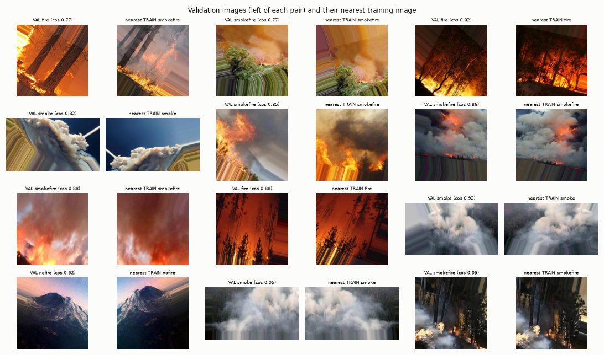
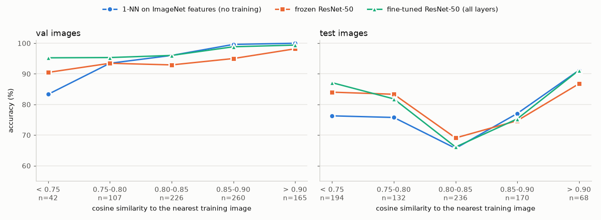
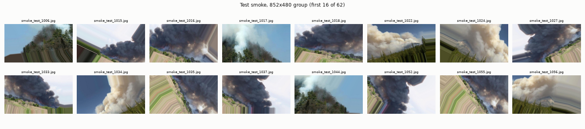
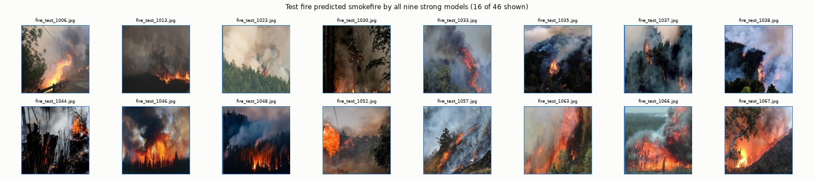

# Results and weaknesses

Ten runs from four tasks, all trained on the same pipeline and split (see `README.md`). Model selection
used validation only. Every number below comes from `notebooks/05_error_analysis.ipynb`, which writes its
tables and figures to `results/analysis/`.

## Summary

- **Best models.** Fine-tuning a whole ImageNet backbone gives the best validation scores: ResNet-50
  97.5 and Xception 96.9 macro F1. On the Kaggle test split, the custom CNN, the frozen ResNet-50 and
  every stage-2 fine-tune land between 76.5 and 78.6, and none of them can be told apart from the plain
  frozen ResNet-50 (78.4).
- **Validation is too easy.** The Kaggle images are augmented copies of source photos, and copies of
  the same photo sit in both train and validation. A nearest-neighbour lookup on ImageNet features, with
  no training at all, scores 97.0% on validation. Validation therefore cannot rank the strong models:
  the Spearman correlation with test is 0.11 over the 7 runs above 93% validation F1.
- **The test split is narrower than 800 images.** Its `smoke` and `smokefire` images come from a different,
  higher-resolution source and are copies of a few dozen photos. Errors come in blocks, and the real
  uncertainty on test macro F1 is about +-4-7 points, not +-2.7.
- **Most test errors are shared.** All nine strong models fail on the same 94 test images. Most of these
  look like a disagreement over where `fire` ends and `smokefire` begins, more than like a model
  failure.
- **The models are confidently wrong.** 78% of the fine-tuned ResNet-50's test errors have confidence
  above 0.9.

## 1. Where the models stand

| Run | Val macro F1 | Test macro F1 | Test, 95% interval (image / cluster bootstrap) |
|---|---:|---:|---|
| Basic NN | 67.9 | 60.9 | [57.5, 64.2] / [51.9, 69.0] |
| Custom CNN | 95.6 | 76.5 | [73.5, 79.2] / [68.8, 83.1] |
| Frozen Xception | 89.9 | 74.6 | [71.7, 77.4] / [68.1, 80.6] |
| Frozen ResNet-50 | 94.6 | 78.4 | [75.7, 81.0] / [71.0, 85.2] |
| Fine-tuned Xception (all layers) | 96.9 | 78.3 | [75.5, 80.9] / [71.2, 84.5] |
| Fine-tuned ResNet-50 (all layers) | **97.5** | **78.6** | [75.8, 81.1] / [70.8, 85.8] |

The cluster bootstrap resamples groups of visually near-identical test images (section 3) instead of
single images. Compared with the frozen ResNet-50, only the basic NN, the frozen Xception and the
stage-1 Xception are clearly worse under both bootstraps. Every other difference has an interval that
includes zero. The ten-run table is in `README.md`.

## 2. Weakness 1: validation measures recall of seen photos

The dataset was built by augmenting source photos: rotation, flips, shifts and zoom, with the empty
borders filled by stretching the edge pixels (the streaks visible on many images). The Kaggle train/val
split, and the re-split used here, divide the copies, not the photos.

The figure pairs val images, sampled from the 10th to the 97th percentile of similarity, with their most
similar training image. At least 10 of the 12 pairs are visibly the same photo after a rotation, flip or
shift. A difference hash of the full image matches only 0.2% of val images, because the copies are
transformed rather than byte-identical.

| | Val | Test |
|---|---:|---|
| Median cosine similarity to the nearest train image | 0.855 | 0.814 |
| 1-NN accuracy (ImageNet ResNet-50 features, no training) | **97.0%** | 74.5% |
| Best trained model, accuracy | 97.5% | 77.9% |

On validation, accuracy rises with similarity to the training set, from 95.2% (fine-tuned ResNet-50) and
90.5% (frozen) on the 42 least similar images to 99.4% and 98.2% on the 165 most similar. The trained
models do better than lookup on unfamiliar validation images, so they are not only memorising. However,
roughly half of validation (425 of 800 images above cosine 0.85) is answered almost perfectly by lookup
alone. As a result:

- the validation numbers overstate generalisation by a few points;
- differences of 1-3 points between strong models are the size of this effect, so validation cannot rank
  them (Spearman with test 0.11 for the 7 runs above 93%; 0.70 over all 10 runs, carried by the clearly
  weaker ones);
- early stopping and checkpoint choice are made on an easy proxy.

## 3. Weakness 2: the test split is another source, with few originals

| Class | Train (median size) | Test (median size) | Test image sizes | Test clusters (distance 0.25 / 0.15) |
|---|---|---|---:|---|
| fire | 250x250 | 250x250 | 1 | 94 / 181 |
| nofire | 250x250 | 250x250 | 1 | 137 / 187 |
| smoke | 299x184 (50k pixels) | 852x480 (409k pixels) | 8 | **31 / 98** |
| smokefire | 250x250 | 835x493 (381k pixels) | 10 | **14 / 42** |

Test `smoke` and `smokefire` images have 6-8 times more pixels than their training counterparts and come
in a few size groups. Each group holds a handful of photos repeated many times. In the group of 62 test
`smoke` images at 852x480, the first 24 show only three or four distinct photos, each rotated, flipped and
shifted:

Consequences:

- The test `smoke` and `smokefire` scores reflect a few dozen scenes, not 200 images each. When a model
  misreads one scene, it fails on all its copies.
- Image-level bootstrap intervals (+-2.7) are too narrow. Resampling clusters instead gives +-4 to +-7
  points for a single model's test F1 (table in section 1).
- Validation holds none of this source. Its `smoke` images are small web images like the training ones,
  so nothing during training or selection sees high-resolution video-like frames.

## 4. Weakness 3: the `fire` / `smokefire` boundary differs between splits

All nine strong models fail on 94 test images; 141 images are missed by at least seven of the nine. On
validation, the same counts are 2 and 9.

| Test label -> what at least 7 of 9 models predict | Images |
|---|---:|
| `fire` -> `smokefire` | 60 |
| `smoke` -> `smokefire` | 52 |
| `smokefire` -> `smoke` | 23 |
| everything else | 6 |

**`fire` predicted `smokefire`.** Most of the 16 shown below (of 46 test `fire` images that every model
rejects) have a large smoke plume next to the flames. That fits the class definition of `smokefire` ("both
smoke and fire"), while the training `fire` images we inspected show flames with little smoke. A
nearest-neighbour lookup makes the same call: it gives `smokefire` to 72 of the 200 test `fire` images,
close to the trained models' 64-82. Of 12 such errors compared with their nearest training image, none is
a copy of a training photo. This looks more like a labelling convention that the training split does not
teach than like a model failure.

**`smoke` predicted `smokefire`.** The first 24 of the 31 images that all nine models miss come from
about five photos. The most frequent, a smoke column against a blue sky, appears 11 times. Another is an
orange-lit smoke cloud, which the models probably read as flame.

**`smokefire` predicted `smoke`.** 11 of the 12 images that all nine models miss are copies of one 900x506
photo, a smoke cloud over trees with barely visible flames. The twelfth (`smokefire_test_1158`) has its
flames at the left edge, outside the center crop.

## 5. Weakness 4: confident mistakes

| Run | Test errors | Median confidence on test errors | Test errors above 0.9 | Val errors above 0.9 |
|---|---:|---:|---:|---:|
| Frozen Xception | 209 | 0.77 | 31% | 12% |
| Custom CNN | 190 | 0.92 | 55% | 23% |
| Frozen ResNet-50 | 178 | 0.96 | 62% | 28% |
| Fine-tuned Xception | 179 | 1.00 | 82% | 32% |
| Fine-tuned ResNet-50 | 177 | 1.00 | 78% | 35% |

Under the test shift, the stronger the model, the more certain it is when it is wrong, and fine-tuning
makes this worse. A confidence threshold would not flag these errors for a human to review.

## 6. Weaknesses of each model

- **Basic NN.** It underfits: 67.9 on validation, and it was still improving at epoch 28 of 30. Flattening a
  64x64 image throws away the spatial structure. It predicts `smoke` for 56 test and 80 validation
  `nofire` images (test `nofire` F1 66.1, against 92.7-99.2 for the other runs).
- **Custom CNN.** Trained from scratch, it matches the frozen ResNet-50 on validation (95.6). On test,
  recall on `smoke` images of the `other` shape drops to 45%, and 67 test `smoke` images are called
  `smokefire`. It was still improving at epoch 46 of 50.
- **Frozen Xception.** Its ImageNet features fit this data worst: 4.7 points under ResNet-50 on validation
  and 3.8 on test. Fine-tuning closes the gap (96.9 / 78.3), and it was still improving at epoch 19 of 20.
- **Fine-tuning.** It adds 2-8 validation points over stage 1 (ResNet-50 +2.4 to +2.9, Xception +5.0 to
  +8.1), but test does not move for ResNet-50, and fine-tuning increases overconfidence (section 5). Given sections 2-4, most of the validation gain is fitting the
  training sources better.

## 7. Checked and ruled out

- **The center crop cutting the fire away.** Averaging the predictions of three square crops (left/top,
  center, right/bottom) changes test macro F1 by -0.1 to -0.3 and validation by at most +0.1, for the three
  best runs. Apart from single cases like `smokefire_test_1158`, the crop is not the cause.
- **The aspect-ratio shortcut.** The shared pipeline already removed most of it. On the same 800 test
  images, `smokefire -> smoke` fell from 77 errors (old stretched-image ResNet-50) to 44 (frozen ResNet-50)
  and to 28 and 41 (the two all-layer fine-tunes).
- **Exact duplicates across splits.** None were found: no SHA-256 match, and dHash matches are 0.2-0.4%.
  The overlap is through transformed copies.

## 8. What to do next, in order

1. **Split by source photo, not by copy.** Group the 4,800 images into source groups (nearest neighbours
   on embeddings, checked by eye at the borderline), then split train and validation by group. This gives
   a validation set that measures generalisation and can rank models.
2. **Audit the `fire` / `smokefire` labels** of the 94 shared test errors (and the training `fire` images
   with visible smoke), with one written rule for how much smoke turns `fire` into `smokefire`. Report
   test both as labelled and as corrected.
3. **Report test per source.** Use the cluster bootstrap (or one image per cluster) so that a single
   misread photo with 20 copies does not swing the score.
4. **Add independent data.** Use high-resolution `smoke` / `smokefire` images and wide camera views from a
   source outside Kaggle, such as the D-Fire dataset this repository is named after, which has fire and
   smoke box labels that map onto the four classes. Use them for validation first, then for training.
5. **Calibrate.** Fit temperature scaling on the source-disjoint validation set from step 1, and check
   calibration on test before using confidence for alerts.
6. **Run 2-3 seeds** of the strongest configurations once steps 1-2 are done; single-seed differences here
   are within noise.
